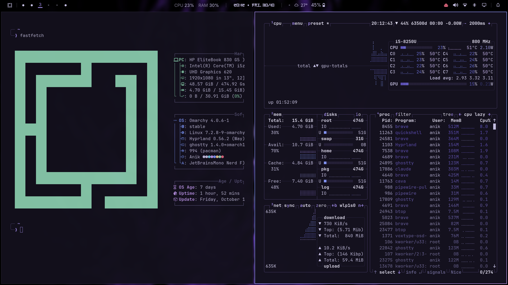
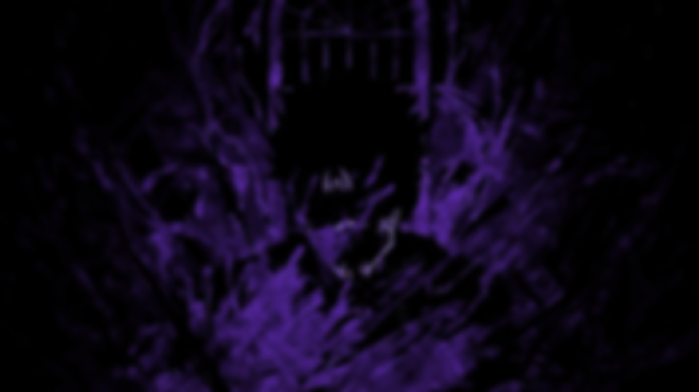

# Anik — an Omarchy theme

Ink-violet glass, lavender text, and a violet glow with electric butterfly-blue
and orchid highlights. A dark theme inspired by the morpho butterfly, with an
optional set of desktop extras: a reworked bar, panels, notifications and
screensaver.



*fastfetch and btop in Ghostty, with the Anik theme and desktop extras.*

<details>
<summary>Wallpaper</summary>



</details>

## Install the theme

```bash
omarchy theme install https://github.com/Anik-tB/omarchy-anik-theme
omarchy theme set anik
```

Or open **Style → Theme → Install** from the Omarchy menu and paste the URL.
Update later with `omarchy theme update`.

## Install the desktop extras (optional)

The theme alone only changes colors. To get the full desktop shown above, run:

```bash
~/.config/omarchy/themes/anik/extras/install.sh
```

The script asks before it changes anything and backs up every file it replaces
to `~/.config/omarchy/anik-extras-backup-<date>/`. To undo, copy those files
back and run `omarchy restart shell`, or reset to Omarchy's defaults with
`omarchy refresh shell` and `omarchy refresh config hypr/looknfeel.lua`.

Optional extras: `cava` for the audio visualizer (`omarchy pkg add cava`), and
the free [Electroharmonix](https://www.dafont.com/electroharmonix.font) font for
the bar clock (it falls back to the normal bar font without it).

## What the extras change

### Bar

- **Clean bar layout:** the menu and workspaces on the left; system stats,
  media, the visualizer, clock, weather and battery in the center; tray, AI
  agents, audio, network, Bluetooth, display and notifications on the right.
- **Dividers** between the right-side groups (apps | connections | system).
- **Colors follow the theme:** the bar reads `colors.toml` live, so it recolors
  instantly when you switch themes.
- **Hand cursor** on everything clickable.

### Widgets and panels

| Widget | What's new |
|--------|------------|
| Workspaces | Active workspace shows its number with a sliding violet underline; others are dots. Number and dot cross-fade with a small bounce, dots grow on hover. |
| CPU / RAM | Plain `CPU n% RAM n%` text that turns warm at 70% and red at 90%. Click for a **System panel**: live CPU graph with one bar per thread, memory bar (used, cache, free) with swap, and the top 5 processes. Right-click opens btop. Lightweight: about 1% of one core. |
| Audio visualizer | A small `cava` spectrum in the theme's accent color. |
| Media | Grows in when something plays, smooth play/pause icon, scrolling titles with soft faded edges. |
| Clock | Decorative Electroharmonix font. The calendar slides and fades between months. |
| Weather | Panel fades in new data and staggers the forecast days. |
| Notification bell | Bell icon with an unread dot and a Do Not Disturb state. Click for a **Notification Centre** with history, Focus and Clear buttons, and smooth dismiss animations. |
| Audio, network, Bluetooth, power, display | Picking an option highlights it **instantly** instead of waiting a second for the system to confirm, with no stale hover outlines. |
| Tray | Faster drawer with fading icons and a rotating chevron. |
| AI agents | Switching between Claude Code and Codex slides and fades the panel. |
| Indicators | Hidden indicators only appear when you hover them, not the whole center of the bar. |

### Notifications

macOS-style cards: frosted surface with the theme's gradient border, rounded
app-icon tile, bold title with "now / 5m ago" time, body up to 4 lines and a
close button on hover. Cards slide in from the right and fold away smoothly when
dismissed. Popups stay for 20 seconds.

### On-screen display

The volume and brightness popup fades, rises and scales in, and its bar animates.

### Screensaver

Omarchy's logo played through a shuffle of terminal text effects, every one
recolored in the Anik violet palette. It starts on idle and from
**Menu → System → Screensaver**. Preview it with `anik-screensaver force`.

### Window look and feel

- Thin violet → blue → orchid gradient border on the active window.
- Quick pop-in window animations, smooth fades, and sliding workspace changes.
- Inactive windows are dimmed slightly.
- Blur only behind the bar and notifications, never behind windows, so it costs
  almost no battery.

### GTK accent

A theme hook sets the GNOME/GTK accent color to purple while Anik is active
(file manager selections, toggles), and back to blue for other themes.

## Palette

| Role       | Color     |
|------------|-----------|
| Background | `#14111e` |
| Foreground | `#c5bfe2` |
| Accent     | `#a08ae6` |
| Blue       | `#7d95f5` |
| Magenta    | `#c29af0` |
| Cyan       | `#73c6e2` |
| Green      | `#8fd4b4` |
| Yellow     | `#e6c58f` |
| Red        | `#e2687f` |

## What's in this repo

- `colors.toml`: the palette. Omarchy generates terminal, Hyprland, Neovim and
  other app colors from it.
- `shell.toml`: Omarchy shell colors (bar, notifications, popups, lock screen).
  The bar background is set to 0.9 opacity. Change `background-alpha` under
  `[bar]` to `0.0` for a fully clear bar.
- `btop.theme`: btop colors, tuned by hand so the graphs stay readable
- `icons.theme`: Yaru-purple icons
- `backgrounds/`: wallpaper
- `extras/`: the optional desktop extras and their install script

## License

MIT. The plugins in `extras/plugins/` are modified copies of
[Omarchy](https://github.com/basecamp/omarchy)'s own shell plugins and remain
under Omarchy's MIT license.
